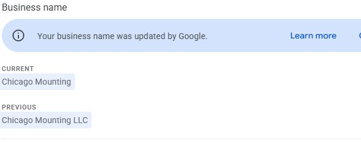

# Chicago Mounting — SEO and Local Search Ranking Investigation

**Current assessment: November9,2026, America/Chicago. Dedicated branch: seo.** This is the active report. The October26 reconstruction and earlier checkpoints are preserved under Historical records below; their dates and unfinished items are not the current report header.

## Executive finding

The reported “about4 to92.9” is not one comparable overall metric.4.3 was the October16 **Samsung Frame TV installation** average. The corresponding October16 **TV mounting** average was15.6. Both keyword identity and measurement methodology must be held constant before interpreting a decline.

There is a real **reporting discontinuity first visible on October30**, but the data do not identify a precise date of real-world Maps visibility loss. The older source was Local Finder and the new source Maps, with a simultaneous20→100 result-depth change documented by BrightLocal. November6 data show poor current Maps coverage, but they cannot prove the business previously held the old Finder positions on Maps.

Fresh coordinate-level verification in this continuation rules out a moved grid for the compared TV mounting runs: **all36 latitude/longitude pairs match exactly across October16, October30 and November6**. Samsung's36 coordinates also match exactly betweenOctober16 andNovember6. This supersedes the earlier “visually same footprint; exact coordinates not obtained” limitation for these specific comparisons. It does not reconstruct every historical account setting or the source migration timestamp.

## Answers to the eight requested questions

| Question | Finding | Dated evidence / source | Confidence |
|---|---|---|---|
|1. Was approximately4 real and comparable? |4.3 is real for Samsung onOct16, with36 ranks4–7. It is not the five-keyword average or the TV mounting baseline; subsequent Maps results use another source. |Authenticated LSGOct16 andNov6; exact keyword menus and point values; B1/B3 below.|High|
|2. When did the reported decline begin? |First stored changed resultOct30; last earlier resultOct16. NoOct23 run. Exact onset within the interval is unknown. |Run history B2, six stored runs.|High for first observation; unknown exact onset|
|3. Did methodology cause/exaggerate it? |Depth substantially amplifies numeric averages. Depth alone cannot explain Samsung4.3→28.7 because every old Samsung point was already within20; the source switch remains confounded with actual temporal change. |M1/M2/M3 and all36point normalization below.|High for inflation/depth limitation; unresolved source-versus-time attribution|
|4. Was actual Maps visibility lost? |Nov6 Maps visibility is poor. A temporal loss on Maps is not established by a Finder-to-Maps comparison. No equivalent historical Maps baseline was obtained. |Nov6 point panels, current rank distributions; old source differs.|High current weakness; insufficient evidence for size/date of Maps loss|
|5. Were tracking settings/profile changed? |No geometric change in exact matched36point sets forTV mountingOct16/30/Nov6 orSamsungOct16/Nov6. CurrentCID matches historical identity evidence. Oct9 is a genuinely different earlier grid. Complete settings/field history unavailable. |DOM marker position attributes; settings B4/B5; GBP name chronology.|High matched geometry/current identity; limited complete history|
|6. Do competitors outrank us in priority cities? |Yes at sampled stored Maps points, for bothTV mounting andTV installation. Performance varies: TV installation is9 at one Wilmette-area point,68 at Evanston-area point,80 at Winnetka-area point and outside100 at sampledGlenview. These are points, not city averages. |Exact coordinates and loadedNov6panels below; previous city sample retained separately.|High point ranks; moderate geographic labeling|
|7. Is there a GBP issue? |Google-applied name update is confirmed; notificationMay9CDT, beforeOct16good Samsung result. No current restriction observed. A historical2025suspension is not a current2026status. Exactactor/time/intermediatefieldchanges unavailable. |Owner notice screenshot, authenticatedGooglemail and same profileID/CID; detailed section below.|High documentedGoogleedit; no causal proof|
|8. What actions are justified? |Preserve production; investigate hub/city organic losses, inspect exactGSC errorURLs, validate actualleads, obtain source-equivalent historicalMaps evidence. No evidence justifies name rollback, category changes or site rebuild. |Cross-platform comparisons and limitations below.|High preservation decision; proposed diagnostics not completed fixes|

## Historical versus current: same exact keywords

| Keyword | Oct16 | Oct30 | Nov6 | Nov6 capped at21 |
|---|---:|---:|---:|---:|
|Samsung Frame TV installation|4.3|27.9|28.7|20.58|
|TV mounting|15.6|92.3|92.9|21.00|
|Outdoor TV installation|8.2|70.5|60.6|21.00|
|Fireplace TV mounting|12.8|40.8|37.3|20.58|
|TV installation|15.2|93.6|89.1|20.53|

Source: authenticatedLSG, inspectedNov9. Capping is an analytical calculation, not a historical Maps scan. Nov6 versusOct30: threekeywords improve, two worsen slightly; there is no new across-the-board collapse between these two post-break runs.

[Official October2026 notes](https://help.brightlocal.com/hc/en-us/articles/40475732070162-October-2026-Release-Notes), re-read in this continuation, confirm both the source and depth transitions, and a pause in movement comparison until two Maps runs. They do not expose this account's exact migration time. The same notes describe a separate RankTracker comparison bug; no evidence identifies that bug as the cause of this LSG series.

### How much is depth arithmetic?

TV mountingNov6 has28points outside100 and eight positions58–70. The documented101 substitution gives3344/36=92.8889, displayed92.9. Replacing all results beyond20 with21 gives21.0. Thus71.89positions of the raw mean are attributable to the deeper scoring of this *same current snapshot*. This arithmetic is not a percentage causal attribution of an actual visibility loss.

ForSamsung, everyOct16 point was4–7, so revealing positions21–100 cannot by itself transform that old snapshot. All36matched point ranks are worse in the new snapshot. This disproves a pure depth-only explanation but does not distinguish Finder-versus-Maps ordering from changes over time.

## New exact-coordinate verification and point evidence

Source: [authenticated LSG](https://app.brightlocal.com/locations/4173610/lsg), Nov9continuation. Read rendered Google Maps marker **position** attributes and displayed rank text, not a hidden application store or guessed map coordinates. Compared sorted coordinate sets programmatically; all36match forTVmountingOct16/30/Nov6. Compared all36SamsungOct16/Nov6coordinates; allmatch. The table records observed geographic sampling points, not the hiddenGBP address or customer locations.

A dash denotes out-of-depth, not zero. For mean arithmetic use21 for old20-depth results and101 for current100-depth results. Table transcription reproduces displayed15.6,92.9,4.3,28.7and89.1 after rounding.

| Latitude, longitude | TV mounting Oct16 | TV mounting Nov6 | Samsung Oct16 | Samsung Nov6 | TV installation Nov6 |
|---|---:|---:|---:|---:|---:|
|42.02888,-87.741209|–|–|4|29|–|
|42.02888,-87.721738|7|–|7|25|88|
|42.02888,-87.702266|5|66|4|20|81|
|42.02888,-87.682794|5|66|4|–|77|
|42.043334,-87.741209|–|–|4|27|–|
|42.043334,-87.721738|6|–|4|25|86|
|42.043334,-87.702266|6|70|4|21|82|
|42.043334,-87.682794|5|61|4|20|16|
|42.057788,-87.760681|–|–|4|28|–|
|42.057788,-87.741209|–|–|4|25|–|
|42.057788,-87.721738|6|–|4|22|82|
|42.057788,-87.702266|6|64|4|20|73|
|42.057788,-87.682794|6|58|4|18|68|
|42.072242,-87.838568|–|–|5|33|–|
|42.072242,-87.819096|–|–|5|32|–|
|42.072242,-87.799625|–|–|4|31|–|
|42.072242,-87.760681|–|–|4|27|–|
|42.072242,-87.741209|–|–|4|25|–|
|42.072242,-87.721738|6|–|4|22|83|
|42.072242,-87.702266|6|64|4|22|9|
|42.086696,-87.838568|–|–|5|33|–|
|42.086696,-87.819096|–|–|4|31|–|
|42.086696,-87.799625|–|–|5|30|–|
|42.086696,-87.760681|–|–|4|32|–|
|42.086696,-87.741209|–|–|4|24|–|
|42.086696,-87.721738|7|–|4|31|81|
|42.086696,-87.702266|6|67|4|25|81|
|42.10115,-87.838568|–|–|5|12|–|
|42.10115,-87.819096|–|–|4|31|–|
|42.10115,-87.799625|–|–|5|29|–|
|42.10115,-87.760681|–|–|4|33|–|
|42.10115,-87.741209|–|–|4|30|–|
|42.10115,-87.721738|–|–|4|29|80|
|42.115603,-87.780153|–|–|4|32|–|
|42.115603,-87.760681|–|–|5|30|–|
|42.115603,-87.741209|–|–|6|29|–|

TV mounting:13/36oldpoints were within20; current0/36within20 and8/36within100. Samsung:36/36oldpoints within20; current5/36within20. These confirm changed recorded ordering at identical coordinates, but not source equivalence.

### Same-point competitor turnover: not an isolated Chicago Mounting anomaly

At **42.02888,-87.721738**, exactkeywordTVmounting, the loaded point panels show:

| Business | Oct16 stored position | Nov6 stored position |
|---|---:|---:|
|Chicago Mounting|7|outside100|
|TV Mounting Same Day|1|83|
|Chicago TV Installer|4|2|
|R&R TV MOUNTING|3|11|
|HDInstalls TV Installation Chicago Co.|5|19|
|Anytime T.V. Mounting & AV|6|37|
|Pro TV Mounting|8|93|
|ProMount TV Mounting|9|99|

Oct30 at this samecoordinate already showsChicagoMounting outside100, ChicagoTVInstaller1, R&R8 andHDInstalls19. Current full100-result list loaded. Nov6also containsMcGrath Subaru Evanston at65 and manyhandyman/construction businesses. This is an observable relevance anomaly worth asking BrightLocal to explain, not proof of an incomplete scan or fabricated data.

The large shifts across multiple TV specialists, alongside relatively stable high placement for another specialist, weaken an explanation focused solely on ChicagoMounting's name change. They are consistent with changed result selection/source, while real competitive movements cannot be excluded. Confidence:high displayedpositions; medium diagnostic implication; no exclusive causal claim.

### TV installation: additional exact samples in four priority areas

Each panel was read after it loaded; the displayed rank was checked against the marker. Early transient panels sometimes retained the previous point's list during loading. Those transient mismatches were discarded, not reported as final competitors or classified as failed scans.

| Sample area | Exact coordinate | ChicagoMounting Nov6 | Loaded top3, in order |
|---|---|---:|---|
|Glenview|42.086696,-87.819096|outside100|Home Systems,Inc.; Home appliances installation; Ben's TV Repair Service|
|Winnetka|42.10115,-87.721738|80|Paul's Winnetka TV Services; LV Home Theater Installation; Chicago TV Installer|
|Wilmette|42.072242,-87.702266|9|Chicago TV Installer; ClearView TV Mounting; R&R TV MOUNTING|
|Evanston|42.057788,-87.682794|68|Chicago TV Installer; Quest Network Services; Minas Electronics|

TVmounting at the same sampledGlenviewcoordinate is outside100; top3HomeSystems,SumoHandymanServices,PutMyStupidThingTogether. Earlier visually selected city points below are separate samples; differing leader order does not imply contradiction when coordinates differ.

Review counts do not explain ordering alone: Nov6ChicagoMounting389/5.0, ChicagoTVInstaller70/4.9, ClearView61/5.0, R&R120/5.0; Winnetka leaderPaul9/5.0. The stored competitor comparison givesChicagoTVInstaller andChicagoMounting the same primaryHomecinemainstallation category. ChicagoTVInstaller has six additional categories versus the tracked row'sServiceestablishment/Audio visualconsultant. More categories are not automatically better; “Service establishment” in a storedGooglelisting is not proof of a currently editable owner category. Proximity remains a hypothesis: no verified origin-to-business distance table was obtained.

## Cross-platform SEO conclusion

GSC Web Oct25–Nov7 versusOct11–24: **107→127clicks;12,182→13,588impressions;20.7→19.2averageposition**. Exactbrandquery accounts17of20netadditionalclicks. GA4OrganicSearchsessions146→176, keyevents18→27; actualleadquality is unvalidated. These are organic/site metrics, notMapsvisibility.

Specific weakness is confirmed despite aggregategrowth: /find-near-me/impressions2634→1884, and fourcitypagescombined452→316. Glenview189→105;Wilmette127→70;Winnetka108→69;Evanston28→72. Ahrefs homepage estimatedtraffic100(+49) versusnear-me1(−32), with stale keywordupdates and anOct22SERP-datawarning. Ahrefs is modeledorganicdata, not actualvisitors or exactMapspositions. Fullpage/query/keywordtables, filters and dates remain in the detailed comparison below.

GSC indexing lastupdatedNov5:81indexed/73notindexed, including27intentional-or-unverifiednoindex and24redirects;4notfound,1other4xx,1robotsblocked,15crawled-notindexed,1discovered. No currentGSCmanualaction/securityissue detected. These counts do not identify a cause of Maps movement. Noindex hold oncases remains.

## GBP name-change conclusion

Google's notice explicitly identifiesChicagoMountingLLC→ChicagoMounting. Authenticated notification sent **May9,2026 23:17:45CDT** (=May10 04:17:45UTC); this dates notice, not exactapplication. CurrentpanelattributesGooglewithoutdate. SameprofileID7994992727831704831/CID18385212719512896326; Oct16report alreadyusesChicagoMounting withSamsung4.3. Oct24photoemail stillusesLLC, so a latercycle/stalefield is unresolved. Namingguidelines require real-worldrepresentation, not an automaticLLCrequirement; officiallegalentitysearch transportfailed. No actor/edit-history audit provingallotherfieldsunchanged was available.

## Status against the requested deliverable

Completed evidence: historical/current keywordmeans; exactmatchinggeometry; all36pointvalues for corekeywords; same-pointcompetitorhistory; both requestedgenerickeywords inpriorityareas; officialmethodologydocumentation; actualGBPfields/name-notificationchronology; GSC/GA4/Ahrefs/RankTracker crosschecks; selectedexactpage/keywordtables; technicalreportstatus.

Unresolved evidence: equivalenthistoricalMapsbaseline, exactaccountmigrationtimestamp, fullhistoricalsettings/GBPfieldactorlog, verifiedcompetitorproximity, legalregistryresult, actualleadattribution. The interfaces examined did not expose the missinglogs/baseline; no supportmessage or paidscan was sent. Therefore a definitive allocation of the residualchange to realMapsvisibility versus source cannot honestly be established.

Visualevidence: historicalSamsung4.3/current28.7 andcurrentTVmounting92.9 screenshots were captured and displayed during thiscontinuation; only theGBPnameimage above is persisted inGitHub. A complete durable ranking-screenshotarchive remains outstanding. This report must not be represented as satisfying that entire requirement.

### Next actions justified; no production edits executed

- Obtain BrightLocal's account-levelsource/migration and historicalequivalentMaps evidence, using the exactcoordinate/samepointturnovertable in a support request if separatelyauthorized. Do not spendcredits withoutapproval.
- Diagnose near-me andthreecitypage query/country/device changes before selectingcontent work. PreservecurrentURL/architecture andSeptemberoptimizationdecisions.
- Inspect actualURLs behind4notfound/1other4xx/1robotsblocking and importantnonindexedpages; do not blanketredirectorindex intentionalexclusions.
- ReconcileGA4keyevents withactualleads and comparableGBPperiods.
- Do not revertLLC or changeGBPcategories/serviceareas based on an unsupportedrankingtheory.
- Complete persistent ranking-screenshotstorage; no claim of completion untilreadbackverified.

---

# Historical records and detailed evidence

The following sections are retained verbatim for continuity. Their original dates, limitations and earlier checkpoint status are historical; the current assessment above supersedes the specific exact-coordinate limitation.

# SEO-звіт — точка продовження
> Latest assessment: see **2026-11-09 / 2026-11-10 UTC — Consolidated SEO assessment and completed GSC/Ahrefs comparison** below. Equal-period GSC clicks107→127 and exact impressions12,182→13,588 contradict a site-wide organic collapse, while /find-near-me/ and three priority-city pages show specific weakness. BrightLocal's source/depth transition breaks comparability; the entire Maps gap cannot yet be attributed to either methodology or real temporal loss. Google's documented name-update notification is fromMay9, before theOct16 good Samsung result. Historical records below are preserved, not silently restated as current facts.

Оновлено 26.10.2026. Відновлений конспект великого аналізу 8–12 жовтня; повний оригінал звіту не знайдено у доступному пошуку файлів. Не видавати цей конспект за оригінальний звіт.

## Підтверджений контекст
Користувач повідомив, що основні зміни сайту були у вересні; бот-трафік блокували через Cloudflare. Тому до/після без очищення періодів і перевірки GA4 не доводить ефект SEO.
12.10 baseline порівнював 13.09–10.10 з 16.08–12.09. Джерела: GSC, GA4, BrightLocal, HTML-аудит.
Числові приватні аналітичні експорти не внесено до публічного репозиторію. Для нового аналізу потрібні актуальні джерела, однакові періоди та фільтри.

## Погоджений фокус
- Чотири міста: Glenview, Evanston, Wilmette, Winnetka.
- Спочатку baseline, потім дослідження Glenview.
- Не просто загальний чекліст: знайти закономірність, сформулювати гіпотезу, зробити обмежену зміну, виміряти ефект.
- BrightLocal — вимірювання; саме створення grid/campaign не є SEO-покращенням.
- Не змінювати production settings без відповідного дозволу користувача. Поточні конкретно авторизовані зміни виконувати в межах їхнього обсягу.

## /find-near-me/
Історичний висновок 12.10: зберегти URL, індексацію, self-canonical, H1 “TV Mounting Near Me in Chicago”; розвивати Service Area Hub, а не замінювати ним міські сторінки.
Канібалізацію не було доведено. Низький CTR не доводить, що проблема лише у title.
Сторінка історично містила райони/передмістя/ZIPs/мапу/CTA та лінки на чотири міста, quote, prices, same-day.
Пропозиції focused refinement: перевірити claims, зменшити зайвий voice-search/same-day текст, корисно пояснити coverage/ZIP. Не робити rebuild за інерцією.
Висновки з давнього файлу — не live-перевірка 26.10.

## Історичний технічний статус
08.10 асистент звітував про виправлений www → non-www HTTP 301 через Cloudflare; GSC 5xx Validate Fix ще потребував дії. Повторно не перевірено.
Date Archives із noindex мали залишатися без масових блокувань/редиректів.
Історія WooCommerce filters / robots є, але точні чинні правила невідомі.
ZIP Checker README нині описує v0.2.3 та staging-ready статус; старі згадки v0.2.0 не є поточною версією.

## План продовження — реконструйований, не дослівний оригінальний P0/P1/P2
1. Відновити оригінальні GSC/GA4/BrightLocal/HTML експорти; зафіксувати дати, зміни трекінгу і бот-фільтрації.
2. Перевірити lead-конверсії: quote submit, booking і call click; не підміняти реальні leads переглядами/кліками.
3. Зафіксувати незмінні параметри geo grid, device/location, п’ять цільових keywords. Точний попередній список keywords не відновлено — не вигадувати його.
4. Glenview: порівняти Top-3 конкурентів за однаковим запитом/локацією, relevance, proximity, відгуками, локальними згадками/посиланнями й сторінками.
5. Для кожної гіпотези записати підставу, очікуваний результат, сторінку/місто, дату, реалізовану зміну, метрику і обмеження.
6. Перевірити ролі й перелінковку homepage / services / city pages / coverage hub, реальні локації кейсів і статус ZIP Checker.
7. Порівняти ефект через 6–8 тижнів від фактичної зміни за сумісними періодами; не пояснювати будь-яку різницю лише SEO.
8. У старій розмові наступний повний аудит пропонували на 9–10 листопада. Це історична пропозиція, не створене нагадування і не гарантія достатності даних.

## Що записувати для кожного наступного SEO-кроку
Дата | місто/URL | джерело | baseline | гіпотеза | погоджена дія | фактична зміна | перевірка | результат/період | невизначеність.
Оновлювати WORK.md і CHANGELOG.md. Не оголошувати загальне SEO-зростання без відповідних даних.

## 2026-11-09 — BrightLocal ranking investigation and cross-platform audit

Investigation date: November 9, 2026, America/Chicago (execution host already November 10 UTC). Status: evidence checkpoint; the reporting discontinuity is established, but a causal attribution of all residual movement to Google or BrightLocal is NOT established. Investigation only: no website, GBP, SEO, tracking, or report configuration was changed; no paid scans were run.

### Dedicated SEO workspace

Branch inventory returned one branch, `claude/chicago-mounting-zip-review-szeoup`, also confirmed as the current default. Created `seo` from default commit `3e56590ad7aa7adb348d4833b4982ecd5f0818d1`. Ongoing SEO audits, monitoring and optimization planning belong on `seo`. No default-branch update or merge is authorized. This section preserves the historical report above; newer evidence does not retroactively verify old claims.

Read AGENTS.md, README.md, PROJECT.md, WORK.md, SEO-REPORT.md, WEBSITE-HISTORY.md, SEO-CONTENT.md, recent CHANGELOG entries and the relevant AUDIT-2026-10-26.md. The older audit already warned that October 9 had different coverage and that the five keywords were not constant across the earliest runs.

### Sources and verification

| ID | Source and date | Evidence and limits |
|---|---|---|
| B1 | [Authenticated Local Search Grid](https://app.brightlocal.com/locations/4173610/lsg), inspected Nov 9 | Chicago Mounting location4173610; historical date menus, rendered point values, competitors and four geographically selected points inspected. Each report section has independent keyword/date controls. |
| B2 | [Original report history](https://tools.brightlocal.com/seo-tools/admin/locations/4173610/lsg/reports/485676/runs/list), inspected Nov 9 | Six stored runs: Oct9 twice, Oct10, Oct16, Oct30, Nov6. No Oct23 run appears. Oct16/30/Nov6 are scheduled. |
| B3 | [Oct16 original run](https://tools.brightlocal.com/seo-tools/admin/location-dashboard/location/4173610/lsg/view?runId=01a14534-0ae6-7384-b709-03d3f86fa58b&keyword=Fireplace+TV+mounting) | Generated Oct16 9:53AM CDT. Keyword list and original competitor table checked, including Chicago Mounting rating5/reviews381. |
| B4 | [Read-only grid settings](https://tools.brightlocal.com/seo-tools/admin/location-dashboard/location/4173610/lsg/edit) | Custom36/49 selected points; 1mile spacing; five exact keywords below; Friday09:00–12:00 Central, within recorded08:00–20:00 opening hours. Nothing saved. |
| B5 | [Location settings](https://tools.brightlocal.com/seo-tools/admin/location-dashboard/location/4173610/edit) | Tracked Google CID18385212719512896326, Chicago Mounting, matching phone/site; service-area business enabled. BrightLocal address is city-level Chicago/60601, not a verified office or ranking origin. |
| M1 | [Official October2026 release notes](https://help.brightlocal.com/hc/en-us/articles/40475732070162-October-2026-Release-Notes), read Nov9 | LSG switched Local Finder→Maps on both platforms; depth20→100; change comparisons held until two Maps runs. Exact account migration date not supplied. |
| M2 | [Current grid documentation](https://help.brightlocal.com/hc/en-us/articles/37025102315666-How-do-I-understand-Local-Search-Grid-New-Platform), read Nov9 | Dash counts101 in current mean. Individual-point lists show up to100 businesses. |
| M3 | [Average calculation article](https://help.brightlocal.com/hc/en-us/articles/360019011800-How-is-my-average-rank-calculated-in-a-Local-Search-Grid-report), read Nov9 | Opened current page says101 for dash/102 for NF. Search's older cached excerpt still says21/22; do not mistake it for current documentation. |
| G1 | [Actual GBP](https://maps.google.com/?cid=18385212719512896326), Google owner interface inspected Nov9 | Public visibility, owner controls, categories, service areas, Google name-update notice and monthly Performance tables read. |
| S1 | [GSC comparison](https://search.google.com/search-console/performance/search-analytics?resource_id=sc-domain%3Achicagomounting.com&start_date=20261025&end_date=20261107&compare_start_date=20261011&compare_end_date=20261024) | Domain property; Web; all countries/devices; two equal14-day periods; observed Nov9, last update4hours ago. |
| A1 | [Ahrefs dashboard](https://app.ahrefs.com/dashboard), inspected Nov9 | Correct Chicagomounting project; Last30days trend preset. Dashboard estimates and technical summary only, not a new crawl or per-keyword history. |
| A2 | [GA4](https://analytics.google.com/analytics/web/#/a190928786p498944746/reports/intelligenthome), inspected Nov9 | Chicago Mounting property498944746, Traffic acquisition, equal14-day comparison set/read back. All users/countries; Organic Search kept separate from Direct. |
| B6 | [Local Rank Tracker](https://tools.brightlocal.com/seo-tools/admin/location-dashboard/location/4173610/lsrc/view), inspected Nov9 | Generated Nov6 9:04AM CST; comparison Oct30; single Chicago,IL origin, different keywords/result types from regional grid. |

### Historical versus current averages — directly verified

| Exact keyword | Oct10 | Oct16 | Oct30 | Nov6 | Nov6 recapped at21 | Nov6 top20 points |
|---|---:|---:|---:|---:|---:|---:|
| Samsung Frame TV installation |11.9|4.3|27.9|28.7|20.58|5/36|
| TV mounting |17.2|15.6|92.3|92.9|21.00|0/36|
| Outdoor TV installation |7.8|8.2|70.5|60.6|21.00|0/36|
| Fireplace TV mounting |17.6|12.8|40.8|37.3|20.58|2/36|
| TV installation |not in exact-case keyword list|15.2|93.6|89.1|20.53|2/36|

Sources B1/B2/B3. Confidence high for displayed report values. The often-cited approximately4 was real for Samsung Frame on Oct16, not a five-keyword overall average. The five Oct16 means average11.22, not4; this derived figure is not a BrightLocal headline metric. Samsung Frame's36 old points were all4–7, so expanding depth cannot alter those old values. Outdoor's old36 points were all within20. Both old and current Samsung Frame snapshots have no top3 point.

First observed discontinuity: Oct30, bounded by the stored Oct16 and Oct30 runs. There is no evidence to identify an exact day within that interval. Oct9's initial25-point map view centered roughly41.848601,-87.863678 is visibly different from the North Shore configuration. Two Oct9 Samsung entries are13.0 and13.3. Do not use these as unchanged North Shore baselines.

Oct16 and Nov6 North Shore overview maps show the same visible footprint,36points and map center42.072242,-87.760681. Current settings match the historical Oct26 record36/49/1mile. Exact per-point latitude/longitude exports and a settings-change log were not obtained; a center in a Google map link is a viewport center, not proof of the GBP's hidden physical origin.

### What the methodology change explains

Calculated from all36 rendered Nov6 point values, replacing a current dash with101 reproduces every displayed average after rounding. TV mounting has28 dashes and eight ranks58–70: total3344/36=92.8889. Thus92.9 is not an observed rank at one point, and a dash is not zero or a failed scan. All four inspected point panels contained actual competitor results; no NF appeared in the five current grids.

A depth-only normalization is mean(min(pointRank,21)), assigning21 to current dashes. It is an analytical comparison, not an edit or a reconstructed Local Finder scan. The recapped values above show how dramatically deeper measurement enlarges the numbers. TV mounting changes15.6→21.0 on the capped scale, rather than15.6→92.9; Samsung Frame still changes4.3→20.58; Outdoor8.2→21.0; Fireplace12.8→20.58; TV installation15.2→20.53.

Confirmed with high confidence: expanded depth greatly exaggerates the raw numerical gap and cannot explain all of it. Source-switch effects remain confounded with actual temporal changes: capping Maps does not turn it into Local Finder. It is not defensible to conclude either “all a BrightLocal artifact” or “Google visibility collapsed by the full raw rank difference.” The account run records inspected did not expose an explicit source-version flag; Oct30 as the first post-switch report is strongly consistent with the timing/depth, but is not an independently proven migration timestamp.

Nov6 versus Oct30 is the closer post-break comparison: Samsung+0.8positions worse, TV mounting+0.6worse, Outdoor9.9better, Fireplace3.5better, TV installation4.5better. There is no fresh across-the-board collapse between these two runs.

### Geographic competition — Nov6 stored Maps results

One map point near each city was selected visually; these are representative points near the labels, not certified municipal centers or complete city averages. Exact point coordinates were not exposed in the panels.

| Point area / keyword | Chicago Mounting | Leading returned businesses | Source / confidence |
|---|---|---|---|
| Glenview / TV mounting |outside top100|1 Put My Stupid Thing Together (5/141reviews);2 Home Systems,Inc. (5/87);3 Ben's TV Repair Service (4.8/260)|B1 point near Glenview; high for ranking, moderate for city-label assignment|
| Winnetka / TV mounting |outside top100|1 r:home (4/4);2 Paul's Winnetka TV Services (5/9);3 Enfuze Chicago (5/24)|B1 point near Winnetka; high/moderate|
| Wilmette / TV mounting |64|1 Chicago TV Installer (4.9/70);2 Village Audio Video (1/2);3 Fix Pro Solutions (5/22)|B1 point near Wilmette; high/moderate|
| Evanston / TV mounting |58|1 Chicago TV Installer (4.9/70);2 Minas Electronics (4.3/82);3 Lakeside Handyman LLC (5/8)|B1 point near Evanston; high/moderate|

Competitors genuinely outrank the tracked listing in these stored Maps results. This was not a fresh manual Google Maps search from each coordinate. Public storefront categories and closer-looking city names do not establish measured distance; no verified distance table was available. Relevance/proximity are hypotheses, not proven causes. See [Google's ranking factors](https://support.google.com/business/answer/7091?hl=en-en): relevance, distance and prominence interact; review count alone is not decisive.

For Samsung Frame across the regional grid, Nov6 competitor means include Chicago TV Installer1.2, Royal Home Entertainment4.0, R&R5.0, HDInstalls9.4, Chicago Mounting28.7. Chicago TV Installer and Chicago Mounting share primary Home cinema installation, yet have70vs389reviews and4.9vs5rating in that snapshot. A lack-of-reviews or wrong-primary-category diagnosis is unsupported by this comparison. Additional categories differ; this does not authorize copying irrelevant categories.

### Actual GBP findings

| Finding | Evidence/date | Confidence and interpretation |
|---|---|---|
| Listing currently visible/manageable |Google public profile and “You manage this Business Profile,” Nov9; correct CID/phone/site|High. No suspension/reverification banner seen in inspected owner views; formal verification-status/appeal history not retrieved. BrightLocal's “Active” is not proof of Google verification. |
| Categories |Owner Business information: Home cinema installation primary; Audio visual consultant additional|High current. BrightLocal also displays Service establishment, an interface/data-source difference, not a demonstrated category removal. No historical category-change log. |
| Business location/service area |Owner interface: no location, deliveries/home services only; Cook,Kane,Lake,Will,DuPage,Kendall,McHenry counties|High current. Hidden address/origin not recovered and not published; service-area list does not establish proximity. |
| Google edited business name |Owner notice current Chicago Mounting; previous Chicago Mounting LLC|High that change exists; date unknown, causal role unknown. Do not automatically revert or acknowledge it. |
| Reviews |Oct16 original table381/5; Nov6 grid389/5; Nov9 live393/5|High per-source snapshots. No aggregate review-loss signal; dates of newest individual reviews not inspected. |
| Duplicates/restrictions |No duplicate established; manager inventory attempt blocked before completion|Unresolved. Do not report a clean duplicate/verification audit. |

### Independent performance evidence

These are aggregate metrics specifically authorized for this SEO report, not raw analytics exports or customer data.

**GSC S1 — later Oct25–Nov7 versus earlier Oct11–24; Web/all countries/all devices:**

| Metric | Earlier14days | Later14days |
|---|---:|---:|
| Clicks |107|127|
| Impressions, exactly as UI displayed |12.2K|13.6K|
| CTR, rounded UI |0.9%|0.9%|
| Average organic position |20.7|19.2|

Confidence high for UI values; unrounded impression totals were not retrieved. Clicks increased18.69%. The exact query “chicago mounting” accounts for17 of the20 net extra clicks. Excluding only that exact query leaves90→93; this is not a complete branded/nonbranded classification.

| GSC exact query | Earlier clicks | Later clicks | Earlier impressions | Later impressions |
|---|---:|---:|---:|---:|
| chicago mounting|17|34|37|57|
| tv mounting chicago|3|4|89|128|
| tv installation chicago|1|3|79|113|
| chicago tv mounting|6|3|18|14|
| tv mounting service|5|2|314|435|
| chicago tv mounting service|0|2|9|13|
| tv wall mount installation near me|1|1|864|318|
| tv wall mounting service|0|1|78|87|
| tv mounting service near me|0|1|41|67|
| tv wall mounting|0|1|14|65|

These rows show mixed query movement, not uniform growth. Current page-level comparative rows were not inspected; no page-level November numbers are fabricated. Historical page-level findings remain in AUDIT-2026-10-26.md and are not reverified here. No causal success attribution to September optimization, November case edits or any other intervention is established. GSC Web average position is not a Maps ranking.

**GA4 A2 — same later and earlier14days, all users/countries, Traffic acquisition:**

| Metric | Earlier | Later |
|---|---:|---:|
| Organic Search sessions|146|176|
| Organic Search engaged sessions|87|116|
| Organic Search engagement rate|59.59%|65.91%|
| Organic Search key events, all configured events|18|27|
| Organic Search session key-event rate|8.22%|9.66%|
| Direct sessions|4,231|10,134|
| All sessions|4,534|10,628|

Organic sessions+20.55%; no aggregate organic traffic collapse in this period. Large Direct totals and low engagement make total traffic a poor local-SEO proxy. Event definitions, deduplication, US-only performance, GBP campaign attribution and CRM jobs/revenue were not validated.27key events do not mean27genuine leads.

**GBP G1 — complete September versus October, plus partial November through inspection:**

| Metric | September | October | November partial |
|---|---:|---:|---:|
| Profile interactions|46|50|9|
| Website clicks|38|48|6|
| Call-button interactions|8|2|3|

Monthly interactions/site clicks did not collapse; call interactions fell on a very small base. These monthly periods cannot isolate a late-October break and November is incomplete. No closed-job or revenue inference.

**Ahrefs A1 — exact displayed dashboard metrics on Nov9, Last30days trend preset:**

| Metric | Displayed current | Displayed change | Limitation |
|---|---:|---:|---|
| Estimated organic traffic|135|+36|Estimated traffic, not measured site visits; card shows value$406|
| Organic keywords|29|-5|US row29/-4 has a different displayed delta; preserve both rather than invent a reconciliation|
| Domain Rating|2|not shown as delta|A proprietary authority score|
| Referring domains|895|-22|Raw count, not link quality|
| Health Score|100|not shown|Existing crawl summary, not a fresh crawl|
| Crawled|606|+77|Existing snapshot|
| Redirects|6|not shown|Not inherently errors|
| Broken|0|not shown|Not a new all-URL HTTP check|
| Blocked|111|+6|Reasons/individual URLs not inspected|

The trend preset did not expose exact start/end timestamps in the inspected dashboard. Do not infer precise calendar bounds or technical cause from it. Card sparklines also show unlabeled endpoints; these are not alternative verified current totals. No Ahrefs keyword-level/page-level comparative table was inspected in this session. The historical Oct26 Ahrefs findings remain historical, including its old SERP-inconsistency warning.

**BrightLocal Rank Tracker B6:** Nov6 vsOct30 summary Average Google Position7.5, change2; Local Pack Coverage50%, displayed change12.5%. Movement direction for those summary glyphs was not robustly extracted, so no sign is invented. It still contains Local Finder and Organic Desktop/Mobile columns for a single Chicago,IL search origin. This is not an equivalent36point Maps series. Do not transpose keyword rank stacks in its dense comparison table into unsupported individual ranks.

### Eight required answers and justified next steps

| Question | Answer | Source/date/confidence |
|---|---|---|
| Was approximately4 real/comparable? |Real4.3 for Samsung on Oct16; not all keywords and not an equivalent pre/post Maps baseline.|B1/B3 Oct16; high|
| When did decline begin? |First observed Oct30; exact onset between stored Oct16/30 cannot be dated.|B2; high for bound|
| Did methodology cause/exaggerate it? |Depth demonstrably magnifies the numerical jump; large residual remains after capping. Finder→Maps may explain some/all residual, but share cannot be separated from real change.|M1/M2+B1 normalization; high for amplification, unresolved causality|
| Did Maps visibility actually decline? |Poor Nov6 Maps visibility is established; historical change in Maps under identical collection conditions is not. Oct30→Nov6 is mixed, with three keywords improving.|B1; high current, unresolved pre-break causal trend|
| Settings/profile changed? |EarlyOct grids/keywords changed; Oct16/Nov6 visible North Shore geometry aligns with current36/49/1mile. Correct current CID confirmed. Complete point export/source-version/GBP-ID-change audit log absent.|B1–B5; moderate continuity|
| Are competitors ahead in priority cities? |Yes at the four inspected stored TV mounting points; no exhaustive city averages or fresh coordinate-controlled Maps validation claimed.|B1 Nov6; high/moderate geography|
| GBP issue? |Visible/manageable, rising snapshot review counts, relevant primary category; Google name edit confirmed without date. No observed suspension, but formal status/history/duplicates checks incomplete.|G1/B3 Nov9/Nov6/Oct16; high observed, incomplete audit|
| What corrective actions are justified? |Correct the measurement baseline/interpretation first. No redesign, mass rewrite, category/address edits or indexing changes justified by these data.|Combined evidence; high|

Remaining evidence collection, not implemented changes:
1. Obtain BrightLocal's source-version/migration timestamp for report485676 and Oct16/Oct30 run IDs, point-coordinate/settings history, missingOct23 explanation and whether historical Finder data were transformed. Prepare a support question; do not send without explicit communication authorization.
2. Compare already stored Maps runs on unchanged points using top3/top10/top20 shares, capped means and exact CID. Obtain parallel Finder/Maps evidence at identical coordinates/time if available without paid scan credits. Source equivalence is the key unresolved root-cause test.
3. Finish formal GBP verification/restrictions/duplicate inventory; date Google's name edit and any location/category changes. Do not change profile data to test a hypothesis.
4. Complete GSC page/query attribution and US/device segmentation, Ahrefs dated keyword/page histories and exact unrounded GSC impressions; maintain the earlier optimization history without attributing performance causally.
5. Validate GBP-tagged GA4 sessions and genuine lead events/CRM outcomes for equivalent periods, especially lateOctober. No paid scan, configuration change, merge or publication authorized by this research task.

**Screenshot and access limitation:** historical Samsung4.3 and current TVmounting92.9 map screenshots were captured and inspected in the conversation, but no persistent screenshot files were saved or attached to this GitHub checkpoint. Report screenshots remain an unfinished deliverable. A later attempt to open the GBP manager was blocked because another Chrome extension UI was open; that inventory was not completed or bypassed. No definitive Google-algorithm diagnosis, full source-equivalent before/after comparison, full duplicates audit or verified business-lead decline is claimed.

## 2026-11-09 — Google Business Profile name-change investigation

### Finding and correction to the earlier checkpoint

The exact transition **Chicago Mounting LLC → Chicago Mounting** is documented in an authenticated Google Business Profile notification sent **May 9, 2026 at 23:17:45 CDT (America/Chicago)**. Its original Date header is May9 21:17:45 -0700; equivalent UTC is May10 04:17:45. This is a notification timestamp and a latest bound for that documented application, NOT a recovered exact edit timestamp. A brief conversational conversion to May10 00:17 was incorrect and was corrected after timezone verification.

This supersedes the earlier report's undated-name-change observation. It does NOT establish that no subsequent rollback/reapplication ever happened. The change was documented more than five months before the first poor stored ranking report of Oct30; the available evidence does not support presenting it as a newly discovered late-October event.

### Primary evidence and confidence

| Evidence | Date / source | Finding | Confidence / limit |
|---|---|---|---|
| Google name-update notification, authenticated email read in full | Sent May9 23:17:45 CDT; Google Business Profile sender; mail authentication headers show SPF/DKIM/DMARC pass | Explicit old/new pair LLC→noLLC; notification describes an update already made via user feedback or automated systems. Links identify profile7994992727831704831 and CID18385212719512896326. | High for notice, transition and identity. Exact application time and underlying contributor are not provided. Private email body, headers, tracking links and recipient information are not committed. |
| Current authenticated owner editor | Inspected Nov9; [Google profile](https://maps.google.com/?cid=18385212719512896326) → Edit profile | Google attributes name update to itself; Current Chicago Mounting / Previous Chicago Mounting LLC. Only name has the inspected Google-update comparison panel. | High current; no date, actor log or historical list exposed. OK/accept/revert/save controls were not used. |
| Current Advanced settings | Nov9, actual owner interface | Business Profile ID7994992727831704831 matches May notice; current CID matches the notice and BrightLocal tracking. | High identity continuity at those observations. Does not prove absence of every historical merge or intermediate state. |
| Stored Oct16 LSG original report | Generated Oct16 09:53AM CDT; [original run](https://tools.brightlocal.com/seo-tools/admin/location-dashboard/location/4173610/lsg/view?runId=01a14534-0ae6-7384-b709-03d3f86fa58b&keyword=Fireplace+TV+mounting) re-opened Nov9 | Business row is Chicago Mounting,381reviews,5rating, primary Home cinema installation; original keyword list includes Samsung4.3. | High for rendered historical report. No immutable raw snapshot export acquired; label rendering alone is weaker than the dated Google email. |
| Stored Oct30 LSG original report | Generated Oct30 12:29PM CDT; [original run](https://tools.brightlocal.com/seo-tools/admin/location-dashboard/location/4173610/lsg/view?runId=01a18ddb-e712-72f4-8778-6e20a6515031&keyword=Fireplace+TV+mounting) | Same row name Chicago Mounting,386reviews,5rating, primary Home cinema installation; Fireplace40.8. | High displayed facts; exact archived CID not independently exported. |
| Existing GBP Audit | Generated Nov6 01:42:59, timezone not labeled; [stored audit](https://tools.brightlocal.com/seo-tools/admin/location-dashboard/location/4173610/gpw) | Name Chicago Mounting; exactCID link; website root; phone+12245198272; primary Home cinema installation; address blank; daily08:00–20:00. | High rendered summary; this tool also loads live rolling Insights, so their later Last Updated label is not the audit's capture date. No new run started. |
| Contradictory name in a later photo email | Sent Oct24 07:08:12 CDT, authenticated Google notification | Uses Chicago Mounting LLC, but links to the SAME profileID/CID as May/current. | High that a message uses that label. It is not a dated field-change notification and cannot prove the public name was reverted. |
| Earlier profile restriction history | Suspension notice Oct17,2025 00:45:18 CDT; rejected appeal notice Oct17,2025 21:04:23 CDT, same profileID | Historical2025 restriction is real; not a new2026 suspension finding. | High historical identity/date. Reinstatement date not recovered; current owner/public visibility is separately observed. Old address, routing details and private correspondence excluded. |

### Screenshot — actual owner interface, Nov9

Actual browser screenshot cropped to the name field, Google attribution and both values; no reconstructed/mock UI and no private account identifiers. The cropped image was visually inspected and its transferred bytes checked against the capture in27consecutive blocks before commit. This resolves the screenshot gap for this specific name-change evidence; the broader ranking report screenshot archive remains incomplete. The screenshot proves the current notice, not its application date. No email screenshot/raw email is published.

### Was it automatic, suggested, or performed by a manager?

**Confirmed:** Google's current editor categorizes the name as a Google update. The May email reports an update already made and gives two possible source classes: user feedback or automated systems. This is not merely an unapproved pending suggestion in the inspected current UI.

**Not established:** which of those source classes actually triggered this specific update; whether a public contributor, owner, manager or data supplier submitted underlying information; a named editor; a manager acceptance/reversion timestamp; or a later recurrence. No evidence identifies a manager as the direct actor. A manager's access or a current automated-update setting is not an edit-history record.

The Business information menu, Business Profile settings and Advanced settings exposed no dated field-edit log. The menu's Notifications opens notification preferences, not a historical event inbox. Those preferences were read only. Existing GBP Audit's Actions offers re-run/edit/export/print, not a historical field-change log; no re-run or paid scan clicked.

Google's official [update documentation](https://support.google.com/business/answer/3480441?hl=en) explains that updates can use user reports and other sources. [Edit-status documentation](https://support.google.com/business/answer/3038311?hl=en) distinguishes accepted/pending edits from Google's own updates. These describe possible mechanisms; they do not identify this event's submitter. Current policy review windows cannot date the May event.

### Chronology versus rankings

| Date | Name evidence | Ranking relevance |
|---|---|---|
| May9,2026 23:17:45 CDT | Explicit Google notice of LLC→noLLC on current profileID/CID | The documented transition predates the lateOctober difference. |
| Oct16,2026 | Historical BrightLocal business row already Chicago Mounting | Samsung4.3 coexists with the noLLC name. Removal of LLC is not shown to be sufficient to cause poor rankings. |
| Oct24,2026 | Photo email still calls same profile LLC | Contradiction retained. Stale notification/template data versus a true intervening name cycle remains unresolved; neither is declared fact. |
| Oct30,2026 | Historical row still Chicago Mounting | First stored poor report, not a newly proven name-edit date. |
| Nov6,2026 | Grid and GBP Audit use Chicago Mounting | Same visible name as the better Oct16 report. |
| Nov9,2026 | Google editor confirms Current/Previous without date | Cannot interpret an undismissed panel as evidence of a recent change. |

Mailbox searches included all folders, Spam and Trash; focused business-name/update queries, the businessprofile sender and Google Maps sender. The exact transition notice found is the May message. No separate September–November name-change notice was returned by the performed searches. BrightLocal-specific search found an Oct9 AI-priorities email, not a name-change log. Absence in this mailbox is not proof no notice exists in another manager's account or that all past mail is retained.

**Causal assessment: no actual evidence links this documented name change to the Oct30 ranking difference.** The same noLLC name appears in the better Oct16 and poor Oct30 report views. Source/depth changes and incomplete edit history remain separate issues. This is stronger evidence against treating the May transition as the immediate lateOctober cause, not proof that business names can never affect local rankings. No rollback experiment is authorized or warranted.

### Did other fields change at the same time?

| Field | Verified observations | What cannot be established |
|---|---|---|
| Primary category | Home cinema installation in Oct16 and Oct30 report rows, Nov6 GBP Audit and Nov9 owner editor | No contemporaneousMay value or complete edit log. No observed October primary-category switch. |
| Additional categories | Historical rows Service establishment+1more; current Google editor Audio visual consultant; prior BrightLocal Nov6 comparison showed Service establishment and Audio visual consultant | Service establishment is displayed differently across sources; do not infer its removal or exact timing from this. Full historical category arrays unavailable. |
| Address / SAB | Nov6 audit blank address; Nov9 editor no customer-facing location, deliveries/home services only.2025 restriction notice carried a street-address representation. | Hidden origin and date of any address→SAB change not obtained. Do not republish the old address as an active office or blame it for2026 rankings. |
| Service area | Current Cook,Kane,Lake,Will,DuPage,Kendall,McHenry counties, no new update badge seen | Historical area lists forMay/lateOctober absent; unchanged status not proved. |
| Website | Nov6 audit and current owner editor https://chicagomounting.com/ | BrightLocal's editable location record contains a GBP UTM URL; that configuration difference is not evidence of a dated Google website edit. |
| Phone | Nov6 audit+12245198272 and current editor(224)519-8272 | Same number, formatting only. No May timestamped baseline or full history. |
| Business identity | May and Oct24 email links plus current Advanced settings share profileID7994992727831704831; May/current/BrightLocal shareCID18385212719512896326 | No demonstrated replacement profile tied to the name event; historical merges and all intermediate IDs not comprehensively audited. |

The May update email names only the name field. Its generic mention of other possible information types is not evidence that address or hours also changed in that event. No other current field was seen with a matching old/new Google-update panel. These are observation limits, not a guarantee that no field ever changed.

### Naming guidelines, website and legal identity

Official [Google naming guidelines](https://support.google.com/business/answer/3038177) favor the consistently used real-world business name. Legal suffixes such asLLC require real-world supporting usage when included; incorporation alone does not make the suffix mandatory in the public profile name. The policy does not mean that everyLLC suffix is automatically forbidden.

The retrieved [homepage](https://chicagomounting.com/) and [About page](https://chicagomounting.com/about-us/) use Chicago Mounting branding, including logo/page titles; retrieved text searches found noLLC on those two pages. These are search-retrieved copies, not a fresh certificate of all live website content. Direct browser homepage access reached Bot Verification/reCAPTCHA; no challenge solved or bypassed. Current Google profile description still mentions Chicago Mounting LLC, confirming mixed representations exist.

Official Illinois Secretary of State entity search was opened and an individual Business Name search for Chicago Mounting submitted. The result request failed with ERR_HTTP2_PROTOCOL_ERROR at apps.ilsos.gov/businessentitysearch/businessentitysearch. No registry entity result or legal filing was retrieved; this is NOT “no entity found.” Exact legal entity name, status and any assumed-name registration therefore remain unverified. No certificate bought and no personal/legal filing details copied. [Official registry overview](https://www.ilsos.gov/departments/business-services/business-searches.html).

**Justified action:** preserve the current profile during investigation. Do not addLLC for a ranking hypothesis, accept/dismiss the Google notice, change categories/address/service areas or rename the legal entity. If final naming verification is needed, obtain existing business registration and consistent customer-facing branding evidence. If precise actor/application history matters, request Google's historical field events through an authorized support process; no support message was sent here.

### Remaining uncertainties

- Exact application timestamp versus the May9 notification timestamp.
- Whether the current undated panel is the same May event or a later identical recurrence.
- Underlying source/contributor and any intermediate manager reversion/acceptance.
- Why the Oct24 photo email retainsLLC despiteMay notice and Oct16 noLLC report; not resolved by guessing.
- Historical service-area/address/additional-category changes and reinstatement timing for the2025 event.
- Official legal identity verification blocked by registry transport failure; direct live website inspection blocked by reCAPTCHA.
- No causal evidence currently justifies attributing the lateOctober ranking gap to this name change.

## 2026-11-09 / 2026-11-10 UTC — Consolidated SEO assessment and completed GSC/Ahrefs comparison

This section supersedes the earlier “page-level GSC/Ahrefs tables unfinished” checkpoint. Historical sections above remain intact. Read-only authenticated inspection; no website, GBP, indexing, tracking or SEO setting changes, paid scans or new crawls. Ahrefs labels its comparison 10 Nov 2026 versus 10 Oct 2026; that platform date is retained explicitly.

### Decision summary and root-cause boundaries

**Confirmed:** the available evidence does not show a site-wide organic collapse. GSC Web clicks rose from107 to127, exact impressions from12,182 to13,588, and GA4 Organic Search sessions from146 to176 in equal14-day windows. However, /find-near-me/ lost750 GSC impressions and the four priority-city pages combined lost136. Organic growth at the homepage can conceal local-page weakness.

**Confirmed:** BrightLocal's old4.3 average was one keyword (Samsung Frame TV installation), not the overall five-keyword baseline. The first observed reporting break is Oct30, after Oct16. Finder→Maps and depth20→100 break comparability; re-capping at21 still leaves deterioration. Thus methodology substantially exaggerates the numeric gap but is not sufficient evidence to explain every difference. Current stored Maps results are poor at the sampled north-shore points. The proportion due to changed source versus actual temporal visibility loss remains unidentifiable without equivalent-source evidence.

**Confirmed:** Google's documented LLC removal notification predates this break by months (May9 CDT); the October16 name was already Chicago Mounting while Samsung averaged4.3. No causal evidence supports renaming as a remedy. See the preceding detailed name investigation, screenshot and contradictory Oct24 email evidence.

**Not established:** that September website optimizations caused the aggregate gains; that Maps leads declined in the lateOctober interval; an algorithmic penalty; a current suspension; or a competitor/category/proximity mechanism explaining the complete gap. Concurrent measurement changes, branded-query growth and incomplete lead attribution prevent those conclusions.

### GSC: exact property-level comparison

Source: authenticated [GSC Performance](https://search.google.com/search-console/performance/search-analytics?resource_id=sc-domain%3Achicagomounting.com&start_date=20261025&end_date=20261107&compare_start_date=20261011&compare_end_date=20261024), domain property chicagomounting.com, search type Web, all countries/devices, equal14-day periods. Values read directly from comparison cards and tables; exact impression totals from displayed element titles rather than rounded K labels. Confidence: high for displayed values, no causal attribution.

| Metric | Oct11–24 | Oct25–Nov7 | Change |
|---|---:|---:|---:|
| Clicks |107|127|+20 (+18.69%)|
| Impressions |12,182|13,588|+1,406 (+11.54%)|
| CTR, displayed |0.9%|0.9%|rounded, unchanged|
| Average organic position |20.7|19.2|1.5 positions better|

The exact “chicago mounting” query contributed17 of the20 net additional clicks (17→34; impressions37→57). Excluding only that single exact query yields90→93 clicks; this is not a complete non-brand filter. Examples of other query changes: “tv mounting chicago”3→4 clicks/89→128 impressions; “tv installation chicago”1→3/79→113; “chicago tv mounting”6→3/18→14; “tv mounting service”5→2/314→435; “tv wall mount installation near me”1→1/864→318. GSC Web organic positions are not Google Maps ranks.

### GSC: page-level gains and losses

Source/settings/dates as above, Pages tab,100 rows selected, all73 comparison rows inspected. Table is a selected analytical summary, not a raw confidential export. URL paths are on https://chicagomounting.com. Confidence: high. No page/query average-position changes are invented where not extracted.

| Page path | Clicks old→new | Impressions old→new | Impression delta |
|---|---:|---:|---:|
| / |56→71|4,134→5,225|+1,091|
| /find-near-me/ |2→1|2,634→1,884|−750 (−28.47%)|
| /same-day-tv-mounting/ |3→3|412→942|+530|
| /tv-installation-and-mounting/ |1→2|702→872|+170|
| /frame-tv-mounting-chicago/ |3→1|284→430|+146|
| /outdoor-tv-installation/ |0→2|133→198|+65|
| /prices/ |3→1|134→236|+102|
| /commercial-tv-display-mounting/ |2→1|578→735|+157|
| /audio-and-media-installation/ |1→1|843→842|−1|
| /lg-g5-oled-fireplace-mount/ |0→6|66→252|+186|
| /flat-vs-tilt-tv-mounts-which-is-right-for-your-living-room/ |17→15|1,095→1,287|+192|
| /how-much-does-tv-installation-cost-in-chicago-real-pricing-explained/ |2→4|508→404|−104|
| /recessed-media-box/ |2→4|88→94|+6|
| /tv-installation-in-glenview/ |1→0|189→105|−84|
| /tv-installation-in-evanston/ |0→0|28→72|+44|
| /tv-installation-in-wilmette/ |0→0|127→70|−57|
| /tv-installation-in-winnetka/ |0→0|108→69|−39|

Four-city total: clicks1→0; impressions452→316 (−30.09%). Evanston improved impressions; the other three declined. Very small click counts prevent strong conversion or statistical conclusions. More impressions but fewer clicks on Frame/prices/commercial pages is observable; a title or content defect is not thereby proven. Two Frame-related URLs appearing in GSC does not establish cannibalization.

GSC's separate overview recommendation showed /find-near-me/ impressions−54% for Oct27–Nov2 versus Oct20–26. That is a different seven-day comparison and must not replace the−28.47% fourteen-day result. Together these observations justify a targeted hub/query investigation, not a site redesign.

### Ahrefs: keyword-level comparison and freshness limits

Source: authenticated Site Explorer, project10403453, chicagomounting.com/ subdomains, all locations, Organic keywords, comparison10Nov2026 versus10Oct2026, **Monthly volume**. Inspected all47 comparison rows.47 is the comparison union including lost keywords, not47 currently ranking keywords. Dashboard current count29 uses its own presentation. Banner explicitly warns about a22Oct SERP data update and possible data inconsistencies following changes in how Google serves results.

Traffic is Ahrefs modeled monthly organic traffic, not measured visitors; positions are Ahrefs organic SERP observations, not the Local Search Grid. Several rows are stale, including “lost” rows whose latest update predates the comparison interval. Their status cannot date a real loss toOct30. Confidence: high for displayed rows; low for exact timing/causal interpretations.

| Keyword | Organic position old→new | Current modeled traffic | Traffic change | Displayed last update |
|---|---:|---:|---:|---|
| tv mounting service chicago |1→2|31|+25|2 days ago|
| tv installation chicago |3→2|26|+8|11 days ago|
| commercial tv installation |11→10|18|+13|Oct16|
| chicago tv mounting |2→2|12|+1|Oct17|
| outdoor tv installation near me |New→3|11|+11|Oct19|
| frame tv installation near me |New→11|6|+6|Oct11|
| cost to mount tv on wall |New→7|4|+4|12 days ago|
| professional mounting service |New→6|3|+3|7 days ago|
| someone to mount my tv |New→1|3|+3|11 days ago|
| chicago tv installation |4→5|3|no delta displayed|Oct16|
| commercial tv mounting |8→5|2|+1|22 hours ago|
| same day tv mounting service |New→7|2|+2|3 days ago|
| dismount tv service |New→6|2|+2|3 days ago|
| same day tv mount |6→10|1|−2|Oct20|
| tv installation services near me |7→Lost|0|−17|Sep14|
| tv install near me |9→Lost|0|−3|Sep15|
| tv installation service near me |8→Lost|0|−3|Sep17|
| local tv installers near me |8→Lost|0|−2|Aug20|
| tv mount services |11→Lost|0|−2|Aug18|
| tv mounting cost |8→Lost|0|−5|Sep13|

“New” means new in Ahrefs comparison, not newly published on the website. Modeled traffic can rise while rank worsens, as the first row demonstrates; volume/model changes must not be misreported as ranking improvements. Several lost near-me terms point to /find-near-me/. This agrees directionally with GSC's fresh page-impression loss, but the old Ahrefs update dates prevent treating it as independent proof of the lateOctober event.

### Ahrefs: page-level comparison

Source: authenticated [Top pages](https://app.ahrefs.com/site-explorer/top-pages?projectId=10403453&target=chicagomounting.com%2F&mode=subdomains&country=all), dates10Nov versus10Oct, **Average volume**, Changes:Absolute display.13 page rows read. This report displays total estimated traffic138; earlier dashboard135 and keyword report use different view/volume settings. Do not combine them into one exact baseline. Confidence: high for displayed estimates, medium for direction when GSC corroborates, low for event timing.

| Page path | Estimated traffic current (delta) | Current keywords (delta) | Current estimated traffic value (delta), USD |
|---|---:|---:|---:|
| / |100 (+49)|12 (+3)|351 (+190)|
| /outdoor-tv-installation/ |12 (+12)|1 (+1)|19 (+19)|
| /same-day-tv-mounting/ |6 (−2)|3 (−1)|25 (−0.58)|
| /tv-installation-and-mounting/ |5 (+5)|1 (+1)|13 (+13)|
| /how-much-does-tv-installation-cost-in-chicago-real-pricing-explained/ |3 (+3)|1 (+1)|3.4 (+3.4)|
| /tv-dismounting/ |3 (not displayed)|1 (−1)|7 (+0.21)|
| /flat-vs-tilt-tv-mounts-which-is-right-for-your-living-room/ |2 (not displayed)|4 (+2)|0.16 (−0.19)|
| /commercial-tv-display-mounting/ |2 (+1)|1 (−1)|0.84 (+0.41)|
| /prices/ |1 (not displayed)|1 (not displayed)|0.66 (not displayed)|
| /frame-tv-mounting-chicago/ |1 (+1)|1 (+1)|4.3 (+4.3)|
| /find-near-me/ |1 (−32)|1 (−10)|1.7 (−67)|
| /Blog |1 (−7)|1 (−2)|0 (−12)|

One additional low-volume wall-type article row showed estimated traffic1, one keyword and value0; its exact URL was not retained, so it is omitted from the path table. No rewrite is justified by Ahrefs' automated “Overhaul” content-change labels. These tables measure outcomes, not proof that a specific previous edit worked.

### Technical SEO: actual GSC status, not a blanket error count

Source: authenticated GSC Page indexing, **last update Nov5,2026**; observed during this continuation.81 indexed,73 not indexed across7 nonzero reasons. Confidence: high for report counts; affected-URL intent and present live behavior were not individually re-tested.

| Non-indexing reason | URLs |
|---|---:|
| Excluded by noindex |27|
| Page with redirect |24|
| Not found (404) |4|
| Blocked due to other4xx |1|
| Blocked by robots.txt |1|
| Crawled, currently not indexed |15|
| Discovered, currently not indexed |1|
| Redirect error |0|
| Server error5xx |0|

Noindex and redirects can be intentional; the73 total is not73 SEO defects. Existing Case Studies noindex/review hold must remain. Zero5xx in this report is evidence of the current report state, not proof of which prior server fix caused recovery. Four404s and oneother4xx justify inspecting their actual URLs and internal links before any redirect or deletion. Crawled/not-indexed15 and discovered1 require checking importance, canonical and intent before calling them defects.

Manual actions: **No issues detected**. Security issues: **No issues detected** (both pages opened directly). These checks do not establish absence of all algorithmic changes.

Overview enhancement cards: HTTPS42 valid/0 invalid; Breadcrumbs42 valid/0 invalid; Product snippets29 valid/0 invalid; Review snippets599 valid/0 invalid. These are enhancement/report counts, not unique page totals. Core Web Vitals: insufficient data/no data for desktop and mobile, not a pass. Ahrefs' pre-existing crawl health100,606 crawled,0 broken and111 blocked was read without a new crawl; it does not override GSC exclusions or constitute fresh exhaustive technical validation.

### Actions supported by the evidence

1. Preserve current production settings and approved page architecture. Do not revert the GBP name or rewrite optimized pages to react to incomparable Maps averages.
2. Prioritize /find-near-me/: use its query-level GSC comparison, country/device segmentation and canonical/index status to distinguish lost demand, lost ranking and CTR change. Preserve the existing Service Area Hub URL/role and four city pages. Current evidence supports investigation, not a preselected rewrite.
3. Investigate Glenview, Wilmette and Winnetka page query losses individually; Evanston provides a useful contrasting page but is too small a sample to prove a successful tactic.
4. Inspect actual URLs behind4 GSC404s,1other4xx,1robots block and important nonindexed pages. Preserve intentional noindex/redirect exclusions. No fix or validation request was submitted.
5. Obtain BrightLocal's per-run source/version and exact coordinate/settings continuity, and a comparable Maps baseline or equivalent historical results. No paid scan is authorized by this investigation. Without this, quantify the reporting break but do not assign its residual to an algorithm or business change.
6. Validate GA4 quote/booking/call events against actual lead outcomes and review a comparable lateOctober GBP performance interval when available. Current key events and monthly calls do not prove lead recovery or collapse.
7. For GBP chronology only if needed: recover field-event/actor history and resolve Oct24 LLC email inconsistency; confirm official legal/branding evidence. No rollback is supported.

### Evidence and completion limits

All above analytics values were read through the authenticated interfaces and transcribed as selected aggregate summaries. No raw private exports, email headers, customer details, credentials or session tokens are committed. Existing source links, historical BrightLocal tables, methodological calculations, sampled competitors, GBP fields and the actual cropped Google-name screenshot remain in the preceding report. Persistent screenshots of GSC/Ahrefs and all historical ranking grids were not saved; the name screenshot is the saved visual artifact, not a substitute for those missing images. Do not claim a complete screenshot archive.

This completes the previously missing page/keyword comparison and current GSC technical-status summary. It does not resolve unavailable equivalent-source Maps history, historical field edits, official legal-registry transport failure, or lead attribution. Those are explicit evidence limits rather than inferred causes.
